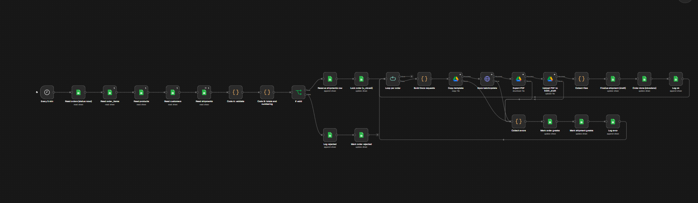
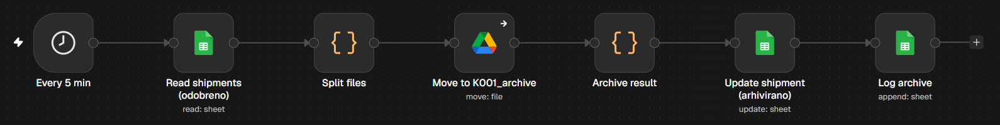

# Sales order to draft invoice and packing list (n8n + Google Sheets + Google Docs)

Demo of a small export-operations automation. A sales order row in a Google Sheet becomes a draft commercial invoice and a draft packing list as PDFs. A person approves by changing one status cell; approved drafts are moved to an archive folder.

**All data in this demo is synthetic.** Every PDF carries the mark "SAMPLE, NOT FOR CUSTOMS USE". It is not a customs document and does not replace one.

## What it does

1. **WF1, draft generator** (Schedule Trigger, every 5 minutes)
   - reads orders with status `novo` and their lines, products and customers
   - validates each order (required fields, incoterm and currency lists, 1 to 8 lines, integer quantity above 0, price above 0, known SKU, known customer)
   - computes line totals, subtotal, total net weight, estimated packages (net kg divided by 25, rounded up)
   - reserves the next invoice, packing list and shipment numbers (`INV-YYYY-NNNN`, `PL-YYYY-NNNN`, `SH-NNNN`) as a row in `shipments`
   - for each valid order: copies the Google Docs templates, fills the placeholders (Docs API `replaceAllText`), exports both as PDF, uploads them to a draft folder
   - writes the file IDs and status `draft` to `shipments`, sets the order to `obradeno`, writes a log row
   - invalid orders are logged with the reasons and set to `greska`; if the PDF step fails, the order and shipment are set to `greska` and the error is logged
2. **Approval (manual):** set `status` to `odobreno` in the `shipments` tab. Only there.
3. **WF2, archive** (Schedule Trigger, every 5 minutes)
   - reads shipments with status `odobreno` and empty `archived_at`
   - moves both PDFs to the archive folder, sets `arhivirano` and `archived_at`, writes a log row

No LLM is used. Validation and calculations are plain Code nodes.




## Repository contents

```
k001-order-to-invoice/
  README.md
  workflows/
    WF1_draft_generator.json
    WF2_archive_approved.json
  sample/
    INV-2026-0005.pdf      (sample commercial invoice, draft)
    PL-2026-0005.pdf       (sample packing list, draft)
  screenshots/
    wf1-draft-generator.png
    wf2-archive-approved.png
```

The workflow JSON files contain placeholders (`<SPREADSHEET_ID>`, `<TEMPLATE_INVOICE_DOC_ID>`, `<TEMPLATE_PACKING_DOC_ID>`, `<FOLDER_TMP_ID>`, `<FOLDER_DRAFT_ID>`, `<FOLDER_ARCHIVE_ID>`) and no credentials. The template IDs are set in the code of the node "Build Docs requests", the other IDs in the Google Sheets and Google Drive nodes.

## Google Sheet layout

| Tab | Columns |
|---|---|
| orders | order_id, order_date, customer_id, incoterm, currency, payment_terms, ship_to, status |
| order_items | order_id, line_no, sku, qty, unit_price |
| products | sku, description, hs_code, origin, unit_weight_kg, dims_cm |
| customers | customer_id, name, address, country, contact |
| shipments | shipment_id, order_id, packages_est, total_weight_kg, invoice_no, packing_no, invoice_file_id, packing_file_id, status, created_at, approved_at, archived_at |
| log | ts, order_id, step, result, error |

Set the spreadsheet locale to `en_US` (decimal point), otherwise numbers are read wrongly.

Order status: `novo` -> `u_obradi` -> `obradeno` (or `greska`).
Shipment status: `u_obradi` -> `draft` -> `odobreno` -> `arhivirano` (or `greska`, `greska_arhiva`).

## Setup

- Credentials in n8n: Google Sheets OAuth2, Google Drive OAuth2, Google Docs OAuth2 (the Docs call is an HTTP Request node using the Google Docs credential).
- Create two Google Docs templates with `{{placeholders}}`:
  - header fields: `invoice_no`, `invoice_date`, `packing_no`, `order_id`, `order_date`, `customer_name`, `customer_address`, `ship_to`, `incoterm`, `currency`, `payment_terms`, `subtotal`, `total`, `total_net_kg`, `packages_est`
  - eight table rows per template: `{{i1_n}} ... {{i8_n}}`, with `_sku`, `_desc`, `_qty`, `_price`, `_total` (invoice) and `_ukg`, `_lkg`, `_dims`, `_origin` (packing list)
- Create three Drive folders: draft, archive, temp (temporary Docs copies).
- Import the workflow JSON, replace the placeholder IDs (spreadsheet, templates, folders), select your credentials.

## Known limitations

- Maximum 8 lines per order (fixed template rows). Orders with more lines are rejected, not truncated.
- Package count is an estimate from net weight; weights are net, gross weight is not calculated.
- HS codes are stored in the `products` tab but are not printed on the documents. No tariff lookup.
- Reserved numbers are not reused: a failed order leaves a gap in the numbering.
- Two executions that start in the same second can read the same `novo` orders. Tested: a second execution started while the first was running produced unique numbers. Not tested: two simultaneous starts. Keep each run shorter than the 5 minute interval (about 15 seconds per order).
- The temporary Docs copies are not deleted by the workflow.
- If one PDF of an order is uploaded and the other fails, the uploaded one stays in the draft folder.
- Status values in the Sheet are in Croatian (`novo` = new, `u_obradi` = in progress, `obradeno` = processed, `greska` = error, `odobreno` = approved, `arhivirano` = archived). They are plain strings in the filters and Code nodes; to change them, replace them in both workflows and in the Sheet.
- Not included: customs declarations, carrier tracking, accounting export.

## Possible next steps

- Real package split and gross weight, column widths in the templates
- Per-line HS code on the packing list
- Cleanup of temporary Docs copies
